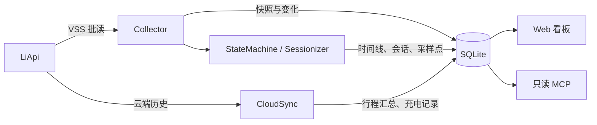

# 项目架构与数据流

LiAuto-Mate 为一个账号、一辆车记录数据。后台通过「理想同学」通道采集车况，Web 看板和 MCP 查询复用 SQLite 中已有的采样。本文描述仓库中的实现，早期选型和实车观察见[可行性与设计方案](可行性与设计方案.md)。

## 从启动到采集

1. `liam serve` 读取 `LIAM_*` 环境变量和当前工作目录的 `.env`，打开数据目录中的 `liam.db`，执行迁移并加载凭据加密密钥 `.secret.key`。Web 和后台任务在同一 Uvicorn 进程内共用 `Database` 连接。多个实例使用同一份有效会话和 VIN 会重复采集。[配置](../liam/config.py) · [进程装配](../liam/cli.py)
2. FastAPI 启动时，`SessionKeeper.start()` 从 `SessionStore` 恢复凭据，尝试刷新会话并保存轮换后的值。空库进入 `need_login`，Web 仍可使用。`/healthz` 表示服务可响应，`/api/v1/system/status` 可查看账号会话状态。[SessionKeeper](../liam/auth/session_keeper.py) · [SessionStore](../liam/auth/session_store.py)
3. 设置页首次绑定 VIN 后写入 `meta.vin`，网页账号登录保存凭据后通知后台恢复会话。这两步可以交换顺序。有 VIN 且会话为 `ok` 时启动实时采集与云端历史同步。`degraded` 仅运行历史同步，`need_login` 暂停两项任务。状态恢复时自动补齐任务，进程退出时先等待采集任务结束，再关闭 HTTP 客户端与数据库。[任务生命周期](../liam/service.py) · [设置与绑定](../liam/web/pages.py)

账号会话状态与车辆状态各自独立。排查「服务正常却没有数据」时，先在设置页核对 VIN 尾号和账号会话，再看概览里的最近采集时间。

## 一次读车如何到达看板

### 轮询节奏

| 车辆状态或任务 | 默认行为 |
| --- | --- |
| `parked_awake` 停车在线 | 每 60 秒读 T1。此分支检查配置档 T2（1 小时）是否到期，执行 T2 时也检查慢档 T3（24 小时）。OTA 和保养取自 T3 的 VSS 快照。 |
| `driving` 行驶 | 继续读 T1，另每 10 秒读一小批定位信号，将有效位置关联到行车会话。 |
| `charging` 充电 | 继续读 T1，另每 30 秒记录电量、功率、电流和电压采样。 |
| `asleep` 休眠 | 每 60 秒用 T0 读取三个连接状态信号，发现苏醒后恢复全量轮询。采集器不主动唤醒车辆。 |
| T4 云端历史 | 独立任务在启动后立即同步，随后每隔 24 小时再次运行，并按保留期清理变化历史。实际执行时间随启动时刻变化。 |

状态机以轮次确认变化。连续两轮离线且相关时间戳停更才进入休眠，行驶转为停车在线需要连续三轮静止。判断新鲜度要看持续上报的连接或里程信号，位置和充电状态在值不变时也可能长期保留旧时间戳。充电枚举与 `Trip.Total.accMileage` 的物理单位仍待实车标定。[分档路径](../liam/collector/paths.py) · [调度](../liam/collector/collector.py) · [状态机](../liam/collector/state_machine.py)

### 数据落在哪里

| 要回答的问题 | 表与口径 |
| --- | --- |
| 某个信号上次读到什么，何时变化？ | `state_latest` 按 `(vin, path)` 覆盖快照。`state_history` 只在首次见到或值发生变化时追加。`ts_ms` 来自车端，`ingested_at_ms` 是本地入库时间。默认 90 天的保留期仅清理 `state_history`，设为 0 可永久保留。 |
| 车辆何时行驶、充电或休眠？ | `states` 保存状态区间，`end_ms IS NULL` 表示区间仍开放。进程重启时从未闭合区间恢复车辆状态。 |
| 一段行程或充电有哪些细节？ | `drive_sessions` 关联 `positions` 和 `drive_soc_marks`，`charge_sessions` 关联 `charge_samples`。`geofences` 用原始经纬度和半径给地点命名。行车能耗由电量百分比（SOC）差和 `LIAM_BATTERY_KWH` 估算。 |
| 采集器离线期间，云端能补哪些数据？ | `travel_daily` 实际保存月份键 `YYYY-MM` 和近 30 天区间键 `__range30`。`charge_records_cloud` 按 `record_id` 更新。行驶轨迹依赖本地定位采样，无法从月度汇总还原。 |
| 服务自身保存了什么？ | `collector_log` 保存采集批次记录，`meta` 保存 VIN 等元数据，`session_store` 保存 AES-GCM 加密的账号凭据。 |

设置页的整库下载使用 SQLite 在线备份，包含已提交到 WAL 的数据。完整迁移账号会话时仍需保管数据目录中的密钥。

数据库使用 SQLite WAL。迁移 SQL 和 `PRAGMA user_version` 集中在存储层，当前版本为 6。凭据加密密钥随数据目录备份。UI Cookie 的签名密钥另由 `LIAM_SECRET_KEY` 提供，留空时生成并保存到 `meta` 表中名为 `ui_secret` 的记录。[表定义和迁移](../liam/core/db.py) · [凭据密钥](../liam/core/secrets.py) · [会话推导](../liam/collector/sessionizer.py) · [云端同步](../liam/collector/cloud_sync.py)

## 修改功能时从哪里入手

| 改动 | 代码入口 |
| --- | --- |
| 应用装配与网页重登 | [应用工厂](../liam/web/app.py)挂载路由、静态文件和可选 MCP。[LoginFlow](../liam/login/flow.py) 在后台线程处理账号登录并保存会话；[滑块求解](../liam/login/captcha.py)负责缺口/拼图匹配和拖拽轨迹。滑块失败不发送短信，可直接重试；短信发出后才开始 10 分钟冷却。 |
| 云端读取、错误分类和续期 | [LiApi](../liam/auth/li_api.py) 处理协议，账号会话生命周期由 [SessionKeeper](../liam/auth/session_keeper.py) 管理。 |
| 指标计算 | 停车电耗和常去地点在[共享分析模块](../liam/collector/analysis.py)计算，Web JSON 与 MCP 调用同一实现。 |
| 页面、图表和地图 | [页面与 JSON 路由](../liam/web/pages.py)组织数据，[Jinja2 模板](../liam/web/templates/)和[静态资源](../liam/static/)负责展示，无前端构建步骤。轨迹以 WGS-84 存储，高德地图在展示时转换到 GCJ-02。 |
| Agent 查询 | [MCP 工具](../liam/mcp_server.py)读取本地库和看护状态，经 Bearer 鉴权挂载到同一服务的 `/mcp/`。启用条件见 [MCP 接入](../README.md#mcp-接入)。 |
| 协议研究与离线分析 | [spike](../spike/) 保留协议验证脚本，[scripts](../scripts/) 提供路径整理与观察数据分析。生产入口是 `liam/` 包。 |
